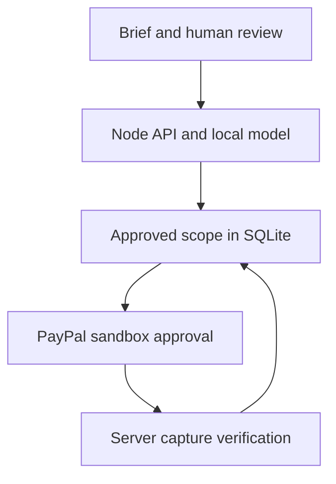

# ScopeProof

**Agree the work. Then get paid.**

An AI-assisted scope review and PayPal sandbox payment prototype for freelancers and small service businesses. Built by Kethana Koppala with AI development assistance for the 2026 PayPal AI Hackathon.

## Current verification status

- Runnable local app, trained local classifier, scope review, approval, immutable change orders and evidence export are implemented.
- 36 automated tests passed on November 11, 2026. Payment tests use controlled API fixtures; they do not prove a real PayPal transaction.
- The browser flow from sample brief through saved scope and approval was exercised.
- **A real PayPal sandbox checkout has NOT yet been completed. Credentials were unavailable during this build.** Checkout is honestly disabled until configured. Do not describe the network integration as verified until the checklist in `docs/VERIFY.md` is completed.
- This package has not been submitted to Devpost. The source is published at https://github.com/Kethana-K/scopeproof . A public YouTube demonstration is still required.

## The problem and the proposed solution

A client asks for a website, then adds social posts, a checkout and “unlimited changes.” A payment link by itself does not establish what work is included. ScopeProof keeps a reviewable description of the work beside the payment handoff.

The model identifies likely service categories and shows its evidence. A person chooses the deliverables, prices, acceptance criteria and revision limit. The server freezes this scope and calculates its SHA-256 fingerprint. The sandbox order carries that fingerprint in `custom_id`; a completed capture is accepted only when the order, scope, currency and amount match. Additional work becomes a separately approved change order.

This is a workflow hypothesis, not a claim that disputes have been reduced. No customer adoption or revenue has been measured.

## Run locally

Prerequisite: **Node.js 24 or newer**. There are no runtime npm dependencies. The trained model is included; Python is unnecessary to run the application.

1. Extract this project and open a terminal in the `scopeproof` folder.
2. Run `npm start`.
3. Open `http://localhost:3000` in a modern browser.
4. Select **Try a sample brief**, then **Analyze the request**.
5. Review the two included deliverables. The vague deadline is flagged and excluded.
6. Enter your own project title and acceptance criteria, review the illustrative prices, and create the scope.
7. Review and approve that exact scope. The payment button remains disabled without sandbox credentials.

To run the automated suite: `npm test`.

The application uses Node's built-in SQLite API. Node may show an experimental SQLite warning; this does not indicate a failed start. Local state is stored in `data/scopeproof.sqlite`.

## Connect a real PayPal sandbox

Use only sandbox merchant and buyer accounts, not live funds.

1. In the official [PayPal Developer dashboard](https://developer.paypal.com/), create or select a **Sandbox** REST application for your sandbox business account.
2. Copy `.env.example` to `.env`. On macOS/Linux use `cp .env.example .env`; on Windows PowerShell use `Copy-Item .env.example .env`.
3. Set `PAYPAL_CLIENT_ID` and `PAYPAL_CLIENT_SECRET` in that local `.env` file. Keep these server-side and out of source control, chat, screenshots and videos.
4. Set `APP_ORIGIN` to the exact browser origin, such as `http://localhost:3000`. Do not mix `localhost` and `127.0.0.1` during a checkout: they have different browser cookies. Set the correct HTTPS origin for a deployment.
5. Restart the app, create and approve a small test scope, and select **Continue to PayPal Sandbox**.
6. Approve using a sandbox personal buyer distinct from the merchant. After returning to ScopeProof, select **Verify & capture test payment**.
7. The UI must show **Sandbox payment verified**, the correct amount and a capture reference. Verify that reference independently in the sandbox dashboard. A return URL alone is never evidence of payment.

The adapter only calls `https://api-m.sandbox.paypal.com`; there is no live mode. `PAY_NOW` is still only a test payment here. See `docs/VERIFY.md` for cancellation, retry and integrity checks.

### Optional webhook

Register the public HTTPS endpoint `/api/paypal/webhook` for `PAYMENT.CAPTURE.COMPLETED` on the same sandbox REST app. Put the resulting registration ID into `PAYPAL_WEBHOOK_ID`. This implementation sends received headers and the event to PayPal's signature verification API, rejects failures, and deduplicates event IDs. It then fetches the associated order and performs the same capture checks. PayPal simulator events are not a substitute for a real, registered app webhook test. Webhook delivery has not been tested on a public host.

## How the AI works

`ml/training.json` contains 80 original, synthetic training examples across website, branding, social content, automation and commerce. `ml/train.py` fits TF-IDF features and a multiclass logistic regression model. Its vocabulary, IDF values, coefficients and intercepts are exported to `ml/model.json`. JavaScript performs the same feature normalization and inference locally on the server.

The UI shows source clauses, influential recognized words, model scores and human-review prompts. Explicit heuristics flag urgency, open-ended wording, negation, and instruction-like input. These heuristics are not presented as learned AI. Scores below the review threshold are left unselected. Category similarity is only a prompt to compare a change request with the original, not a semantic proof that it is already included.

The held-out evaluation contains only 20 synthetic examples. Its result must not be presented as real-world accuracy. Read `docs/MODEL_CARD.md` before interpreting it. This is a small classifier, not an LLM or autonomous payment agent. User text cannot invoke tools or authorize money movement.

To retrain, use Python with scikit-learn installed, then run `python ml/train.py`. This step is optional; judges can run the checked-in model without Python.

## Architecture

| File | Responsibility |
| --- | --- |
| `server.mjs` | HTTP routes, session isolation, approval gates, capture orchestration |
| `lib/ai.mjs` | Local classifier, evidence and conservative scope flags |
| `lib/domain.mjs` | Integer-money validation, quote fingerprint, approval and capture invariants |
| `lib/paypal.mjs` | OAuth, Orders create/get/capture, verified webhook postback |
| `lib/store.mjs` | SQLite workspace storage and webhook replay records |
| `public/` | Accessible HTML controls and responsive CSS without runtime UI libraries |
| `tests/` | Domain and HTTP integration tests, including adverse payment responses |

API routes include `/api/analyze`, `/api/quotes`, per-quote `/approve`, `/order`, `/capture`, `/receipt`, and `/api/paypal/webhook`. Requests that mutate a quote require a same-origin JSON request. Quote totals are calculated on the server from integer cents. Order creation and capture use stable PayPal request IDs and per-quote in-process serialization.

## Prototype boundaries

- The demo uses **one browser workspace**. It records an approval action but does not authenticate a separate client or prove their identity. Do not describe it as a signed client contract.
- Losing the 24-hour workspace cookie loses browser access to those records. There is no account recovery or durable login.
- The browser has responsive CSS, but mobile-device and assistive-technology QA are still pending.
- Brief analysis does not call an external AI service. It runs on the server hosting the app; on a hosted deployment, that host receives the input. The chosen deliverables and acceptance criteria are stored. Quote title, total and fingerprint are sent to PayPal when checkout is requested.
- The system does not implement escrow, automatic refunds, subscriptions, tax calculation, milestone payouts, dispute adjudication, or guarantees. The sample subscription request is work the freelancer might deliver, not a subscription payment capability in this app.
- SHA-256 links a record to an order. It is not a digital signature, identity proof or tamper-proof database. A server administrator could alter local records.
- Deploy only as a single Node process with a writable persistent volume for this prototype. The in-memory rate limiter/locks and local SQLite design are not a multi-instance production architecture.
- Refunds and later reversals are not reconciled. A verified capture is a historical event, not a guarantee of irrevocable payment.
- Use synthetic briefs in a public demo. Before production, add separate authenticated roles, stronger abuse controls, retention/deletion controls, observability, migrations, backups, webhook coverage and wider model evaluation.

## Submission materials

- `docs/DEVPOST_DRAFT.md`: accurate English project copy with explicitly pending verification.
- `docs/DEMO_SCRIPT.md`: a 2:40 demonstration plan; record only actual working behavior.
- `docs/VERIFY.md`: finish-and-submit checklist and honest status record.
- `docs/MODEL_CARD.md`: model scope, data provenance and evaluation limits.

## References and license

[Hackathon overview](https://paypalaihackathon.devpost.com/) · [Official rules](https://paypalaihackathon.devpost.com/rules) · [Orders v2](https://developer.paypal.com/api/orders/v2) · [OAuth](https://developer.paypal.com/api/rest/authentication/) · [Webhooks](https://developer.paypal.com/api/rest/webhooks/rest/)

MIT license. Original implementation, synthetic training data and visual assets are included. PayPal is the integration provider; this project is not an official PayPal product. AI assistance was used for ideation, source code, synthetic examples, documentation and tests. Kethana should review and understand the code and claims before entering it under her name.
